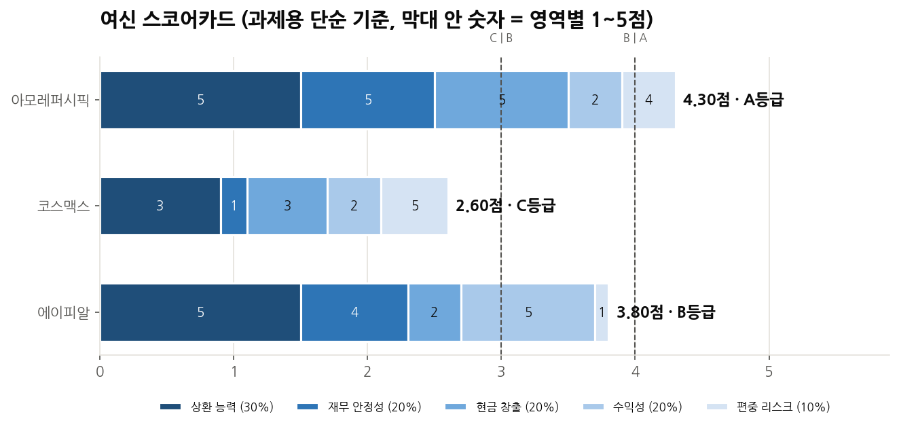
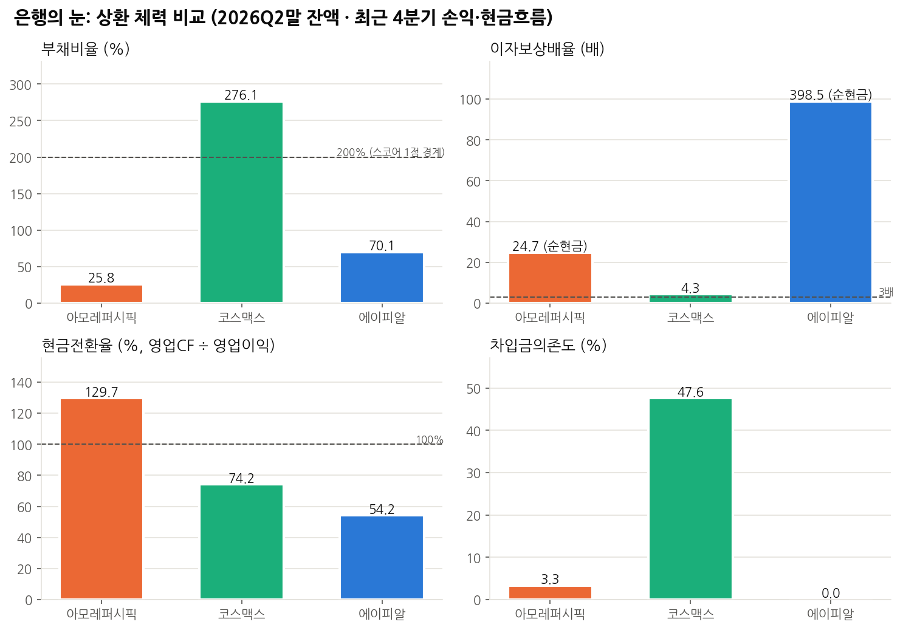
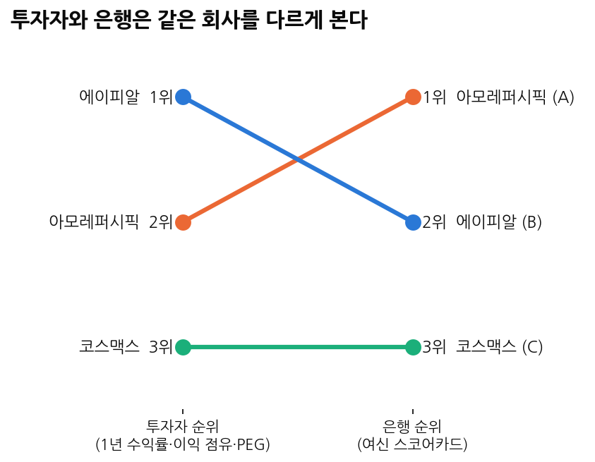
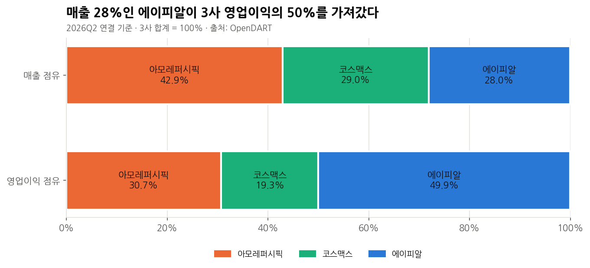
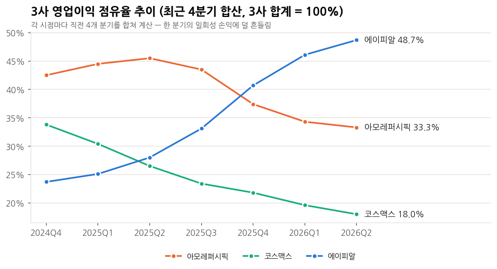
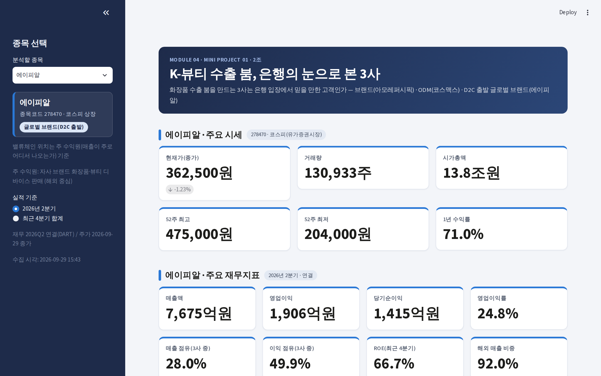

# K-뷰티 3사 여신 스코어카드 — 투자자와 은행은 같은 회사를 다르게 본다

> 아모레퍼시픽·코스맥스·에이피알의 시세와 재무를 코드로 수집해, 투자자 관점(이익·주가)과 은행 관점(상환 능력·현금 창출)으로 비교했습니다.
> **투자자 1위 에이피알이 은행 스코어카드에서는 2위**로 내려갔습니다. 이익이 가장 큰 회사가 현금 회수는 가장 느렸기 때문입니다.

| 항목 | 내용 |
|---|---|
| 형태 | KB Bridge 부트캠프 Module 04 미니프로젝트 01 · 6인 팀 (2조) |
| 사용 기술 | Python (requests, BeautifulSoup, Pandas, Matplotlib) · OpenDART API · Streamlit · SQL (SQLite) · Google Colab |
| 데이터 | 1년 일별 시세 + 분기 재무 2024Q1–2026Q2 + 전체 재무제표 3건 (연결 기준) |
| 핵심 결과 | 은행 스코어카드 아모레퍼시픽 A · 에이피알 B · 코스맥스 C, 실적 발표치와 자동 대조 6개 항목 모두 오차 1% 이내 |

**내 역할** : 주제 검증 · 분석 논리 설계 · 발표 — 공시 수치를 대조해 지주사와 사업회사 수치가 섞인 오류를 바로잡고, PER·PEG 등 비교 지표의 계산 기준을 통일, 재무안정성 지표를 은행 여신 관점에서 해석해 결론 도출



---

## 01. 프로젝트 배경

2025년 화장품 수출은 114억 달러로 늘었고, 무역수지 흑자는 처음으로 100억 달러를 넘었습니다(식약처). 수출이 늘면 은행에는 환전·무역금융·시설자금 수요가 함께 생깁니다.
그래서 "**이 붐을 만드는 회사들이 모두 은행에게 좋은 고객인가**"를 물었습니다. 세 회사는 돈을 버는 방식이 달라(자사 브랜드 판매 / 고객사 제품 생산(ODM) / 해외 중심 브랜드) 같은 붐 안에서 재무 체력이 어떻게 갈리는지 비교하기 좋았습니다.

## 02. 업무 문제

1. **성장의 질** — 같은 붐에서 누가 이익을 가져가나?
2. **상환 체력** — 빌려준 돈을 갚을 힘이 있나? (부채비율·이자보상배율·현금전환율)
3. **신용 리스크** — 무엇이 그 체력을 흔드나? (해외 매출 편중·이익 전망·주가 변동성)
4. **시장 평가** — 시장은 어떻게 보나? (PER·PBR·PEG, 은행에게는 참고 지표)
5. **은행의 판단** — 여신 스코어카드로 종합하면 투자자 순위와 같은가?

## 03. 데이터 설명

| 데이터 | 출처 | 수집 방법 |
|---|---|---|
| 1년 일별 시세 | 네이버증권 차트 데이터 (XML) | requests + BeautifulSoup |
| 시가총액·PER·PBR·EPS | 네이버증권 종목분석 (HTML·JSON) | BeautifulSoup, 두 출처 교차 확인 |
| 분기 재무 주요계정 | OpenDART `fnlttSinglAcnt` | API (2024–2026, 분기·반기·사업보고서) |
| 차입금·이자·현금흐름·재고 | OpenDART `fnlttSinglAcntAll` | API (2025 사업보고서, 2025·2026 반기) |
| 해외 매출 비중 | 각 사 실적 발표·보도 | 수기 입력 + 출처 URL 기록 |

- 원본은 `data/raw/`, 정제·비교 결과는 `data/processed/`에 분리 저장했습니다.
- 수집 성공·실패는 `data/raw/collection_status.csv`에 남기고, 수집이 실패해도 저장된 원본으로 끝까지 실행됩니다.

## 04. 데이터 전처리

| 처리 | 내용 |
|---|---|
| 표기 통일 | `83,469억원` · `8조 7,650억` · `34.62배` 같은 문자열을 숫자(억원·배)로 변환 |
| 계정명 통일 | `매출액 / 수익(매출액) / 영업수익` → 매출액 등 회사마다 다른 계정명을 하나로 |
| 분기 역산 | 4분기 = 연간 − 3분기 누적 (사업보고서에는 4분기만의 값이 없음) |
| 장중 데이터 제외 | 15:40 이전 수집이면 오늘 행은 확정 종가가 아니므로 제외 |
| 공통 거래일 | 3사가 모두 거래한 날만 남겨 비교 기간 통일 |
| 수치 자동 검증 | 2026Q2 매출·영업이익을 각 사 실적 발표치와 대조 → 6개 항목 모두 오차 1% 이내 |

- **지주사 수치 혼입 교정** — 같은 그룹의 지주사와 사업회사 수치가 섞이면 비교가 틀어집니다. 공시 원문과 대조해 분석 대상 법인의 수치만 쓰도록 바로잡았습니다.
- **계산 기준 통일** — PER은 "시가총액 ÷ 최근 4분기 순이익"으로 검산 값을 따로 계산하고, PEG는 이익 감소가 예상되면 계산하지 않도록 기준을 정했습니다.
- 은행 지표마다 실제로 쓴 DART 계정명을 `bank_metrics.csv`의 `사용계정` 열에 남겨 누구나 검산할 수 있게 했습니다.

## 05. SQL 분석

정제 결과 CSV를 SQLite에 적재해 핵심 비교를 SQL로 다시 확인했습니다. → [`sql/scorecard_check.sql`](sql/scorecard_check.sql)

```sql
-- 투자자 순위 vs 은행 순위: 순위가 뒤바뀌는 종목 찾기
SELECT 종목명, 투자자순위, 은행순위, 종합점수, 등급,
       CASE WHEN 투자자순위 <> 은행순위 THEN '순위 바뀜' ELSE '동일' END AS 비교
FROM scorecard
ORDER BY 은행순위;
```

| 종목 | 투자자 순위 | 은행 순위 | 종합점수 | 등급 |
|---|---:|---:|---:|---|
| 아모레퍼시픽 | 2 | **1** | 4.3 | A |
| 에이피알 | **1** | 2 | 3.8 | B |
| 코스맥스 | 3 | 3 | 2.6 | C |

```sql
-- 운전자본 부담: 매출채권·재고가 현금으로 돌아오는 데 걸리는 일수
SELECT 종목명, 매출채권회전일수, 재고회전일수,
       ROUND(매출채권회전일수 + 재고회전일수, 1) AS 운전자본_회전일수
FROM comparison ORDER BY 운전자본_회전일수 DESC;
```

| 종목 | 매출채권 회전일수 | 재고 회전일수 | 합계 |
|---|---:|---:|---:|
| 코스맥스 (ODM 제조) | 76.2 | 51.6 | **127.8** |
| 에이피알 | 30.5 | 58.8 | 89.3 |
| 아모레퍼시픽 | 30.8 | 41.4 | 72.2 |

```bash
python sql/run_sql.py   # 결과 CSV로 SQL 실행 (API 키 불필요)
```

## 06. Python 분석

**여신 스코어카드 (과제용 단순 기준, 실제 은행 심사 기준 아님)**

| 영역 | 지표 | 가중치 | 5점 기준 | 1점 기준 |
|---|---|---:|---|---|
| 상환 능력 | 이자보상배율 | 30% | 10배 이상 또는 순현금 | 1배 미만 |
| 재무 안정성 | 부채비율 | 20% | 50% 미만 | 200% 이상 |
| 현금 창출 | 현금전환율 | 20% | 100% 이상 | 40% 미만 |
| 수익성 | 영업이익률(최근 4분기) | 20% | 20% 이상 | 5% 미만 |
| 편중 리스크 | 해외 매출 비중 | 10% | 40% 이하 | 90% 초과 |

- 종합점수 = Σ(점수 × 가중치) → A 4.0점 이상 · B 3.0점 이상 · C 3.0점 미만
- 손익·현금흐름은 최근 4분기 합계(2025 연간 + 2026 반기 누적 − 2025 반기 누적), 잔액은 2026 반기말 값
- Streamlit 앱에서 가중치 슬라이더를 움직이면 종합점수·등급·순위가 바로 다시 계산됩니다.

전체 코드: [`source/mini_project.ipynb`](source/mini_project.ipynb) · 앱: [`app/app.py`](app/app.py)

## 07. 시각화

| 은행 지표 2×2 비교 (기준선 표시) | 투자자 순위 → 은행 순위 |
|---|---|
|  |  |

| 매출 점유 vs 영업이익 점유 | 영업이익 점유 추이 (최근 4분기 합산) |
|---|---|
|  |  |

| Streamlit 조회 화면 |
|---|
|  |

## 08. 주요 인사이트

| 종목 | 이익 점유 (2024Q4 → 2026Q2) | 부채비율 | 이자보상배율 | 현금전환율 | 해외 비중 | 은행 등급 |
|---|---|---:|---:|---:|---:|---|
| 아모레퍼시픽 | 42.5% → 33.3% | 25.8% | 24.7배 (순현금) | 129.7% | 46.9% | A |
| 코스맥스 | 33.8% → 18.0% | 276.1% | 4.3배 | 74.2% | 37.0% | C |
| 에이피알 | 23.7% → **48.7%** | 70.1% | 398.5배 (순현금) | **54.2%** | 92.0% | B |

1. **이익은 해외 판매 채널을 가진 브랜드로 이동했다.** 에이피알의 이익 점유가 1년 반 만에 두 배로 늘었습니다.
2. **이익이 가장 큰 회사가 운전자금이 가장 필요한 고객일 수 있다.** 에이피알은 장부상 이익의 54%만 현금으로 들어왔습니다. 이익 규모보다 현금 전환을 먼저 봐야 상환 재원의 질을 알 수 있습니다.
3. **빚 부담이 가장 큰 곳은 제조사(ODM)다.** 코스맥스는 부채비율 276%, 유동비율 90%이고 매출채권·재고가 현금이 되기까지 128일이 걸립니다.
4. **같은 회사도 보는 눈에 따라 순위가 바뀐다.** 시장 평가는 미래 기대를, 은행 판단은 상환 능력을 봅니다.

## 09. 생산·제조 업무 활용 방안

| 이 프로젝트 | 생산·제조 현장 적용 |
|---|---|
| 5개 영역 가중 스코어카드 | **협력사(공급업체) 평가표**: 납기·품질·재무 안정성·단일 거래처 의존도에 가중치를 두고 등급화 |
| 투자자 순위 ≠ 은행 순위 | 생산량이 가장 많은 라인이 가장 안정적인 라인은 아님 → 가동률·불량률·고장 빈도를 함께 봐야 함 |
| 지주사·사업회사 수치 혼입 교정 | 공장·라인별 실적이 합산되면 원인 분석이 틀어짐 → **데이터 출처 단위부터 확인** |
| 계정명·계산 기준 통일 | 공장마다 다른 불량 분류명·집계 기준을 하나로 맞춰야 라인 간 비교 가능 |
| 실적 발표치와 자동 대조 (오차 1%) | 시스템 집계값과 현장 실측값을 정기적으로 대조하는 **측정값 교차 검증** |
| 코스맥스 운전자본 128일 | 제조업은 재고가 현금으로 돌아오는 기간이 길다 → 재고 회전·리드타임 관리가 곧 재무 체력 |

## 10. 한계 및 개선 방향

- 스코어카드는 **과제용 단순 기준**이며 실제 은행 여신 심사 기준이 아닙니다.
- 이자비용은 회사마다 공시 위치가 달라 현금흐름표의 이자 지급액 등으로 대신한 경우가 있습니다(사용 계정은 `bank_metrics.csv`에 기록).
- 코스맥스는 차입금 계정 없이 금융부채로만 공시해, 총차입금에 리스부채 등이 섞여 있을 수 있습니다.
- 해외 비중은 회사마다 산출 기준이 다르고, 추정 PER·예상 EPS는 증권사 컨센서스라 수시로 바뀝니다.
- 점유율은 분석 대상 3사 합계 기준이며 K-뷰티 산업 전체가 아닙니다. 투자 권유 목적이 아닙니다.

---

### 실행 방법

```bash
pip install -r requirements.txt
jupyter notebook source/mini_project.ipynb   # 키가 없어도 저장된 data/raw로 끝까지 실행
streamlit run app/app.py                     # http://localhost:8501
python sql/run_sql.py                        # SQL 확인
```

OpenDART 키는 코드에 쓰지 않고 Colab 보안 비밀(`DART_API_KEY`)로 불러옵니다. 컬럼 정의·수집 주소 등 세부 내용은 [`docs/제출용_상세README.md`](docs/제출용_상세README.md)에 있습니다.

### 폴더 구조

```
05_K뷰티3사_여신스코어카드/
├─ README.md
├─ source/        # 수집 → 전처리 → 은행 지표 → 스코어카드 → 시각화 노트북
├─ app/           # Streamlit 앱 (.streamlit/ 테마 설정)
├─ data/          # raw(수집 원본), processed(정제·비교·스코어카드)
├─ sql/           # SQL 확인 쿼리 + 실행 스크립트
├─ output/        # 차트 8종, Streamlit 화면, 인사이트
├─ report/        # 분석결과 요약보고서 PDF
├─ presentation/  # 발표자료 PPT
└─ docs/          # 제출용 상세 README
```
